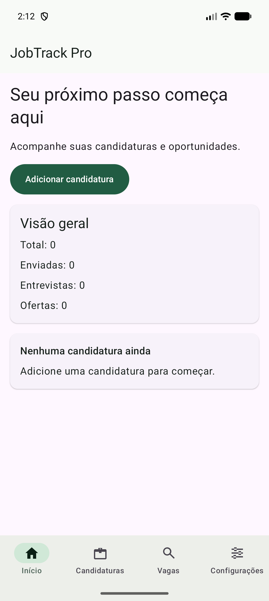
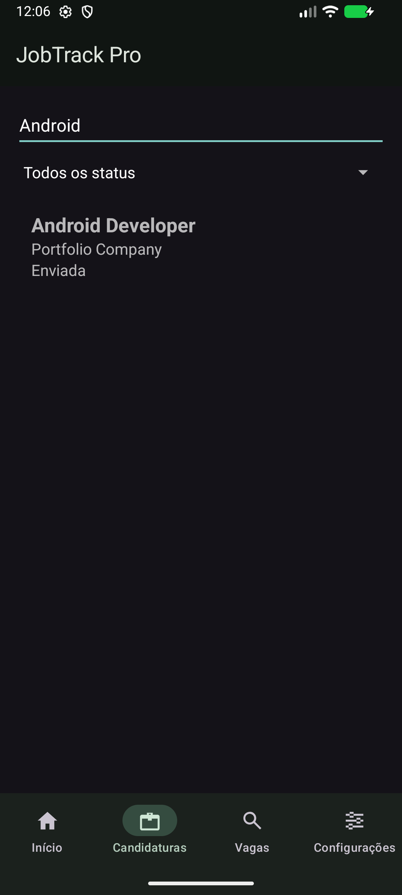

# JobTrack Pro

## Project Overview

A native Android application for organizing job applications, built as a professional
Kotlin portfolio project. It combines Jetpack Compose screens with a real XML-based
application list and uses an offline-first repository architecture.

**Delivery status: implemented and locally verified; partially completed pending production Firebase setup and validation.**
See [verification evidence](docs/VERIFICATION.md) and [roadmap](docs/ROADMAP.md).
The historical [initial audit](docs/AUDIT.md) documents the original scaffold.

## Features

- Firebase email/password registration, login, password recovery and logout.
- Protected navigation and persistent Firebase session.
- Dashboard with totals, interviews, offers and recent applications.
- XML Fragment list with RecyclerView, ListAdapter, DiffUtil, search and typed status filters.
- Compose application creation/editing with validation and retained draft state.
- Details, status changes, HTTPS job links and confirmed deletion.
- Room persistence scoped by authenticated UID, offline CRUD and durable pending changes.
- Firestore transaction-based synchronization, conflict handling and deletion tombstones.
- Arbeitnow REST jobs, search within the loaded page and idempotent job imports.
- User profile, system/light/dark theme preferences in DataStore and synchronization feedback.
- Loading, empty, error and retry states.

## Tech Stack

Kotlin, AndroidX, Material 3, Compose, XML/ConstraintLayout, ViewBinding, Navigation
Compose, ViewModel, Coroutines/StateFlow, Hilt/KSP, Room, DataStore, Retrofit, OkHttp,
Gson, Firebase Authentication and Cloud Firestore. Tests use JUnit, MockK,
kotlinx-coroutines-test, MockWebServer, Compose Testing, Espresso and Firebase rules
testing. Gradle Kotlin DSL and a version catalog define dependencies.

## Architecture

MVVM with immutable UI state, cohesive domain repository contracts and separated
data sources. Room is the UI source of truth; remote synchronization is outside
presentation code. See [architecture](docs/ARCHITECTURE.md) and
[decisions and trade-offs](docs/DECISIONS.md). The
[Portuguese mentoring guide](docs/MENTOR_NOTES.md) explains each stage.

## Module Structure

```text
app
core:common, core:model, core:data, core:database, core:network, core:designsystem
feature:auth, feature:home, feature:applications, feature:jobs, feature:settings
```

The existing app/designsystem and app/home physical directories are mapped to their
logical core/feature paths in settings.gradle.kts.

## Screenshots

Real Android emulator captures using test-created application data:

| Compose dashboard | XML applications list |
| --- | --- |
|  |  |

[Landscape form capture](docs/screenshots/form-landscape.png).
These are captures of the running app, not generated mockups.

## Setup Instructions

1. Open the root project in Android Studio with Android SDK 37 installed.
2. Use a compatible JDK for Gradle. This workspace was built using Android Studio's
   JBR launcher and the wrapper's Java 25 daemon toolchain. Sources target Java 17.
3. Set the SDK path through Android Studio or an ignored local.properties file.
4. Configure Firebase as described below, or run the local emulator configuration.
5. Sync Gradle and run the app on Android 8.0/API 26 or later.

PowerShell example for this machine (adjust to your installation):

```powershell
$env:JAVA_HOME = 'C:\DEV\IDES\AndroidStudio\jbr'
$env:Path = "$env:LOCALAPPDATA\Android\Sdk\platform-tools;$env:JAVA_HOME\bin;$env:Path"
.\gradlew.bat assembleDebug
```

A build without Firebase configuration opens an explicit setup screen, not a fake
logged-in session.

## Firebase Setup

For a real project:

1. Create a Firebase project and register Android package com.app.jobtrackpro.
2. Download google-services.json into app/. The file is ignored by Git.
3. Enable Email/Password in Firebase Authentication.
4. Create a Cloud Firestore database.
5. Review and deploy firestore.rules to your project.
6. Build, register test users and validate authorization and cross-device behavior.

The Google services plugin runs only when app/google-services.json exists.
No service account key or private token belongs in the application repository.
Production resources are not created or deployed automatically by this project.

For local verification without a Firebase account, install Node.js and pnpm, then:

```powershell
pnpm install --frozen-lockfile
pnpm emulators
# In another terminal:
adb reverse tcp:9099 tcp:9099
adb reverse tcp:8080 tcp:8080
.\gradlew.bat :app:installDebug -PfirebaseEmulators=true
```

This debug-only mode uses demo-jobtrackpro, Authentication on port 9099 and Firestore
on port 8080. ADB reverse forwards device loopback (127.0.0.1) to the host.
Run the reverse commands after connecting an emulator or USB device.
Release builds always use normal Firebase configuration, even if the property is set.

## API Configuration

Arbeitnow's [documented public API](https://www.arbeitnow.com/blog/job-board-api)
requires no API key. Retrofit calls
https://www.arbeitnow.com/api/job-board-api over HTTPS. Gson maps the response.

The app loads the first page, caches successful responses for 15 minutes and labels
search as searching loaded vacancies. Coverage is primarily European jobs. Provider
attribution and canonical links are retained. No numeric quota was found in the
consulted documentation; recheck terms before public/commercial distribution.

## Running Tests

See [test naming and formatting conventions](docs/TESTING_CONVENTIONS.md) for the
shared JVM/instrumentation style.

```powershell
.\gradlew.bat testDebugUnitTest
.\gradlew.bat lintDebug
# Start local Firebase emulators and an Android emulator first:
adb reverse tcp:9099 tcp:9099
adb reverse tcp:8080 tcp:8080
.\gradlew.bat :core:database:connectedDebugAndroidTest :core:data:connectedDebugAndroidTest :app:connectedDebugAndroidTest -PfirebaseEmulators=true
```

Unit tests do not require internet or Firebase. Authentication/sync instrumentation
requires the debug emulator property and running local services; those tests are
explicitly skipped without that property. Rules tests can start their own emulator:

```powershell
pnpm test:rules
```

Stop existing Firebase emulators before running that command. With an existing
Firestore emulator, run the test directly instead:

```powershell
$env:FIRESTORE_EMULATOR_HOST = '127.0.0.1:8080'
node --test tests/firestore.rules.test.cjs
```

See docs/VERIFICATION.md for executed checks and limitations.

Verified locally: 31 unit tests, 17 distinct instrumentation tests across the
standard/emulator configurations, and 6 Firestore rules tests. Debug and unsigned
release builds passed. Lint passed with dependency-update notices and no errors.

## Building APK

```powershell
.\gradlew.bat :app:assembleDebug
adb install -r app/build/outputs/apk/debug/app-debug.apk
# Local Firebase demo variant:
.\gradlew.bat :app:assembleDebug -PfirebaseEmulators=true
# Unsigned release artifact:
.\gradlew.bat :app:assembleRelease
```

The debug APK is signed with the standard Android debug key. Release distribution
requires your own signing configuration; keep keystores and passwords outside Git.
A standard build still requires Firebase setup before authenticated features are usable.

## Known Limitations

- Production Firebase project configuration, deployed-rule checks and production
  cross-device validation require developer-provided external resources.
- Synchronization runs while the authenticated app is in the foreground or on a
  manual retry; no WorkManager background schedule is implemented.
- Conflict resolution uses device timestamps with UUID tie-breaking. Bad device
  clocks can affect ordering; tombstones are retained indefinitely.
- Firestore synchronization reads the full account collection, suitable for a
  portfolio-scale dataset.
- Jobs search covers the loaded first page. API availability and content are external.
- Local records are isolated by UID but are not additionally database-encrypted.
  Logout retains records and pending changes on this device.
- App accessibility across all assistive technologies and OEM devices needs broader
  manual validation beyond the recorded emulator checks.
- No fictitious screenshot, unexecuted test or production validation is claimed.

## Future Improvements

Incremental sync, background delivery with WorkManager, server-authoritative conflict
clocks, pagination, a date picker, localization, account deletion/retention controls,
encrypted storage where justified, CI device coverage and production distribution.
