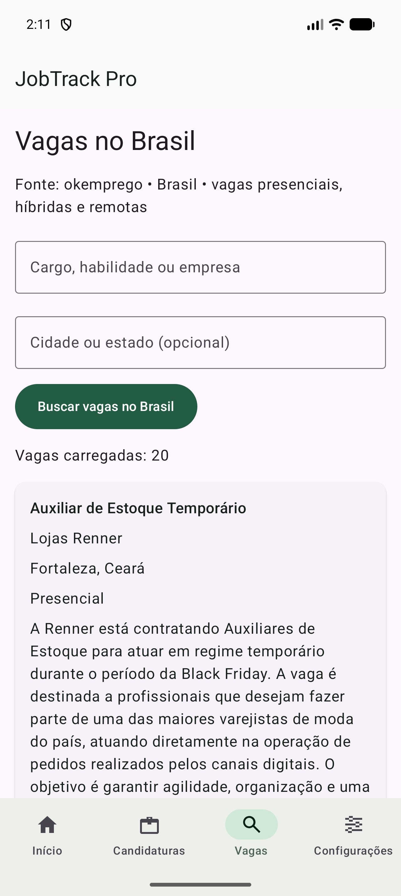

# JobTrack Pro

Aplicativo Android nativo para organizar candidaturas e encontrar oportunidades de
emprego no Brasil. Desenvolvido com Kotlin, Jetpack Compose e interfaces XML, com
armazenamento local por usuário e sincronização com Firebase.

**Kotlin · Compose + XML · MVVM · Hilt · Room · Retrofit · Firebase**

## Visão geral

O JobTrack Pro reúne vagas salvas, candidaturas enviadas, entrevistas e propostas
em um só lugar. O projeto demonstra arquitetura multimódulos, estados observáveis
de interface e integração entre Compose e Views.

O aplicativo e este README estão em português brasileiro. Os identificadores no
código permanecem em inglês.

> [!NOTE]
> O Firebase está configurado e funcionando no projeto: autenticação e sincronização
> fazem parte dos fluxos implementados. Quem clonar o repositório deve fornecer sua
> própria configuração Firebase, pois o arquivo de configuração não é versionado.
> Os comandos e resultados de testes estão no [registro de verificações](docs/VERIFICATION.md).

[Funcionalidades](#funcionalidades) · [Capturas de tela](#capturas-de-tela) ·
[Como executar](#como-executar) · [Firebase](#configuração-do-firebase) ·
[Testes](#execução-dos-testes) · [APK](#geração-do-apk)

## Funcionalidades

- **Autenticação:** cadastro e login com e-mail e senha, recuperação de senha,
  sessão persistente, telas protegidas e logout.
- **Dashboard:** totais de candidaturas, entrevistas, propostas e candidaturas recentes.
- **Gerenciamento de candidaturas:** cadastro, edição, detalhes e exclusão com
  confirmação; pesquisa por empresa, cargo ou localização e filtros por status.
- **Status tipados:** salva, enviada, entrevista, proposta e rejeitada, representados
  no domínio por `SAVED`, `APPLIED`, `INTERVIEW`, `OFFER` e `REJECTED`.
- **Vagas no Brasil:** busca por palavra-chave e cidade/estado, paginação, acesso
  à fonte original e salvamento como candidatura sem importações duplicadas.
- **Dados offline:** operações de cadastro, consulta, edição e exclusão com Room
  para a conta autenticada, mantendo alterações pendentes para sincronização.
- **Sincronização:** transações no Firestore, tratamento de conflitos,
  identificadores estáveis e marcadores de exclusão.
- **Preferências:** perfil básico, temas claro, escuro e do sistema com DataStore,
  além do acompanhamento da sincronização.
- **Estados de interface:** carregamento, lista vazia, validação, erro e nova
  tentativa, com espaçamentos e áreas de toque padronizados.

## Tecnologias

| Área | Tecnologias |
| --- | --- |
| Linguagem e concorrência | Kotlin, Coroutines, Flow, StateFlow |
| Interface | Jetpack Compose, Material 3, XML, ConstraintLayout, RecyclerView, ViewBinding |
| Navegação e ciclo de vida | Navigation Compose, Fragments, ViewModel, coleta de estado respeitando o lifecycle |
| Injeção de dependências | Hilt, KSP |
| Armazenamento local | Room, DataStore |
| Rede | Retrofit, OkHttp, Gson |
| Backend | Firebase Authentication, Cloud Firestore |
| Testes | JUnit, MockK, kotlinx-coroutines-test, MockWebServer, Compose Testing, Espresso, testes de regras do Firebase |
| Build | Gradle Kotlin DSL, Version Catalog, Android Lint |

As versões estão no [catálogo de dependências](gradle/libs.versions.toml).
O aplicativo utiliza SDK alvo 37 e suporta Android 8.0 / API 26 ou superior.

## Arquitetura

MVVM com estados imutáveis de interface e fluxo unidirecional de eventos:

```text
Interface (Compose / XML) → ViewModel → Contrato do repositório
                                                ↓
                                  Implementação do repositório
                                    ↙                  ↘
                               Room / DataStore    Retrofit / Firebase
```

O Room é a fonte de dados observada pela interface de candidaturas. Os repositórios
coordenam as fontes locais e remotas; a sincronização fica fora da apresentação.
O Hilt fornece as implementações dos contratos de domínio. Os modelos de domínio
não dependem dos recursos de interface do Android; os textos visíveis ficam nos
arquivos de recursos dos respectivos módulos.

A lista de candidaturas utiliza um Fragment com ConstraintLayout, RecyclerView,
ListAdapter, DiffUtil e ViewBinding, integrado à navegação Compose.

Consulte a [documentação de arquitetura](docs/ARCHITECTURE.md),
as [decisões técnicas](docs/DECISIONS.md) e a
[revisão de qualidade](docs/QUALITY_REVIEW.md). O
[guia de mentoria em português](docs/MENTOR_NOTES.md) explica as escolhas de
implementação e traz perguntas para entrevistas.

## Estrutura dos módulos

| Módulo lógico | Responsabilidade |
| --- | --- |
| `:app` | Inicialização e navegação principal |
| `:core:common` | Estados de interface e utilitários de falhas compartilhados |
| `:core:model` | Modelos de domínio, validação e contratos de repositório |
| `:core:data` | Repositórios, preferências e sincronização |
| `:core:database` | Banco Room, entidades, DAOs e fonte de dados local |
| `:core:network` | Serviço Retrofit, DTOs e mapeamento de dados de rede |
| `:core:designsystem` | Tema Material e componentes reutilizáveis |
| `:feature:auth` | Login, cadastro e recuperação de senha |
| `:feature:home` | Dashboard em Compose |
| `:feature:applications` | Lista XML, formulários Compose e detalhes de candidaturas |
| `:feature:jobs` | Busca e importação de vagas brasileiras |
| `:feature:settings` | Perfil, tema, sincronização e logout |

O módulo `:core:designsystem` está em `app/designsystem`; `:feature:home` está
em `app/home`. O mapeamento desses diretórios está em
[settings.gradle.kts](settings.gradle.kts).

## Capturas de tela

Capturas reais do aplicativo em execução em um emulador Android:

| Dashboard em Compose | Busca de vagas no Brasil |
| :---: | :---: |
|  |  |

Outras capturas de verificação:
[lista de candidaturas em XML](docs/screenshots/applications-xml.png) ·
[formulário na horizontal](docs/screenshots/form-landscape.png).
Os dados de candidaturas dessas capturas adicionais foram criados para testes.

## Como executar

1. Clone o repositório:

   ```bash
   git clone https://github.com/cicerogusta/JobTrackPro.git
   cd JobTrackPro
   ```

2. Abra o diretório raiz no Android Studio e instale o Android SDK Platform 37.
3. Configure o SDK pelo Android Studio ou por um arquivo `local.properties`,
   ignorado pelo Git.
4. Defina `JAVA_HOME` para um JDK compatível. Os critérios de execução do daemon
   Gradle selecionam Java 25; a compatibilidade do código Java/Kotlin utiliza
   Java 17. Os builds locais foram verificados com o JBR do Android Studio
   e o daemon gerenciado pelo wrapper.
5. Adicione sua configuração Firebase ou utilize os emuladores locais conforme abaixo.
6. Sincronize o Gradle, selecione um dispositivo/emulador API 26+ e execute
   a configuração `app`.

Os comandos abaixo utilizam Windows PowerShell. No macOS/Linux, substitua
`.\gradlew.bat` por `./gradlew`. O primeiro download das dependências e
ferramentas requer acesso à internet. Node.js e pnpm são necessários apenas
para os serviços locais do Firebase e os testes de regras.

## Configuração do Firebase

O Firebase já está funcionando no ambiente do projeto. As instruções desta seção
permitem configurar uma nova cópia do repositório com um projeto Firebase próprio.

### Projeto Firebase próprio

1. Registre um aplicativo Android no Firebase com o pacote `com.app.jobtrackpro`.
2. Baixe a configuração e salve em `app/google-services.json`.
3. Habilite o provedor de e-mail/senha no Firebase Authentication.
4. Crie um banco Cloud Firestore.
5. Revise [firestore.rules](firestore.rules) e publique as regras no projeto escolhido.
6. Compile com `-PfirebaseEmulators=false` e execute o aplicativo.

O plugin Google Services é aplicado quando `app/google-services.json` existe.
Arquivos de configuração, keystores e chaves privadas são ignorados pelo Git.
A compilação não cria recursos externos automaticamente.

Se uma nova instalação exibir **“Configure o Firebase”**, confirme que o JSON está
dentro do módulo `app`, compile novamente e reinstale. Um arquivo somente na raiz
do repositório, ou adicionado depois da geração do APK, não configura o aplicativo
já instalado.

### Emuladores locais do Firebase

Para testar autenticação e sincronização com serviços locais:

```powershell
pnpm install --frozen-lockfile
pnpm emulators
```

Com um dispositivo Android conectado, utilize outro terminal:

```powershell
adb reverse tcp:9099 tcp:9099
adb reverse tcp:8080 tcp:8080
.\gradlew.bat :app:installDebug -PfirebaseEmulators=true
```

Essa configuração de debug utiliza `demo-jobtrackpro`, Authentication na porta 9099
e Firestore na porta 8080. Repita o redirecionamento ADB ao reconectar o dispositivo.
Builds de release sempre utilizam a configuração normal do Firebase.

## Configuração da API

O aplicativo integra a [API do okemprego](https://www.okemprego.com/pt/api)
com Retrofit. A implementação não exige a configuração de uma chave de API.

| Configuração | Comportamento do aplicativo |
| --- | --- |
| Endpoint | `https://www.okemprego.com/api/v1/jobs` |
| País | `country=BR` em todas as requisições; o mapeamento também rejeita outros países |
| Busca | `q` para palavras-chave e `where` para cidade/estado, enviados ao tocar no botão de busca |
| Paginação | 20 resultados por página, mais recentes primeiro, até 200 páginas por conjunto de filtros |
| Cache | Páginas recebidas mantidas por 15 minutos; limite de 20 páginas em memória |
| Falhas | Tratamento de conectividade/HTTP, nova tentativa e mensagem específica para HTTP 429 |

Os IDs do provedor são utilizados para eliminar duplicações. As modalidades remota,
híbrida e presencial são preservadas; quando a fonte não informa a modalidade,
o usuário a seleciona antes de salvar. As descrições aparecem como texto simples,
e cada resultado oferece um link para a fonte original.

A disponibilidade e as condições de uso dependem do provedor. Consulte o
[registro de decisões](docs/DECISIONS.md) para os detalhes e limites da integração.

## Execução dos testes

### Testes unitários e análise estática

```powershell
.\gradlew.bat testDebugUnitTest lintDebug -PfirebaseEmulators=false
```

Os testes unitários utilizam fakes/mocks locais e não dependem de uma API real ou
do backend Firebase. Consulte as [convenções de testes](docs/TESTING_CONVENTIONS.md).

### Testes instrumentados Android

Inicie os serviços locais do Firebase e conecte um emulador/dispositivo Android:

```powershell
adb reverse tcp:9099 tcp:9099
adb reverse tcp:8080 tcp:8080
.\gradlew.bat :core:database:connectedDebugAndroidTest :core:data:connectedDebugAndroidTest :app:connectedDebugAndroidTest -PfirebaseEmulators=true
```

Os testes de autenticação e sincronização exigem os serviços locais e a propriedade
de debug dos emuladores; são ignorados quando essa propriedade está desativada.

### Regras do Firestore

Com os emuladores Firebase existentes parados:

```powershell
pnpm install --frozen-lockfile
pnpm test:rules
```

Para utilizar um emulador Firestore que já esteja em execução:

```powershell
$env:FIRESTORE_EMULATOR_HOST = '127.0.0.1:8080'
node --test tests/firestore.rules.test.cjs
```

**Última validação registrada (11 de novembro de 2026):** 47 testes unitários e
7 testes de interface Compose aprovados, incluindo espaçamento dos botões e
acesso às ações com fonte ampliada. Builds de debug/release e Lint aprovados.
As verificações anteriores de Room, integração Firebase, interface XML e
6 testes de regras do Firestore estão detalhadas no
[registro de verificações](docs/VERIFICATION.md).

## Geração do APK

```powershell
# Build de debug com a configuração Firebase do projeto
.\gradlew.bat :app:assembleDebug -PfirebaseEmulators=false
adb install -r app/build/outputs/apk/debug/app-debug.apk

# Build de debug para os emuladores locais do Firebase
.\gradlew.bat :app:assembleDebug -PfirebaseEmulators=true

# Build de release sem assinatura
.\gradlew.bat :app:assembleRelease
```

| Build | Arquivo gerado |
| --- | --- |
| Debug | `app/build/outputs/apk/debug/app-debug.apk` |
| Release sem assinatura | `app/build/outputs/apk/release/app-release-unsigned.apk` |

O build de debug utiliza a chave de debug do Android. Para distribuir um release,
configure sua própria assinatura e mantenha keystores e senhas fora do Git.
As cópias locais em `artifacts/` são ignoradas e não acompanham o clone do repositório.

## Limitações conhecidas

- A sincronização ocorre com o aplicativo autenticado em primeiro plano ou por
  nova tentativa manual; não há agendamento em segundo plano com WorkManager.
- A resolução de conflitos utiliza horários dos dispositivos e UUID como desempate.
  Relógios incorretos podem afetar a ordenação; os marcadores de exclusão são
  mantidos por tempo indeterminado.
- A sincronização lê toda a coleção da conta, adequada ao volume de um portfólio.
- A cobertura de vagas depende do catálogo do provedor. A paginação pode mudar
  enquanto novas vagas são publicadas; IDs duplicados são filtrados.
- Os registros Room são separados por UID, sem criptografia adicional do banco.
  O logout mantém os dados locais e as alterações pendentes no dispositivo.
- A cobertura manual de TalkBack, Switch Access, fabricantes e tablets ainda pode
  ser ampliada. A distribuição de release requer configuração de assinatura.
- A interface está disponível em português brasileiro.

## Melhorias futuras

- Sincronização incremental e envio em segundo plano com WorkManager.
- Horários de conflito definidos pelo servidor e políticas de retenção.
- Novas fontes de vagas e suporte a outros idiomas.
- Seletor de data e exclusão de conta.
- Maior cobertura de dispositivos, integração contínua e distribuição com assinatura.

O [histórico de etapas](docs/ROADMAP.md) reúne o planejamento e a evolução do projeto.
